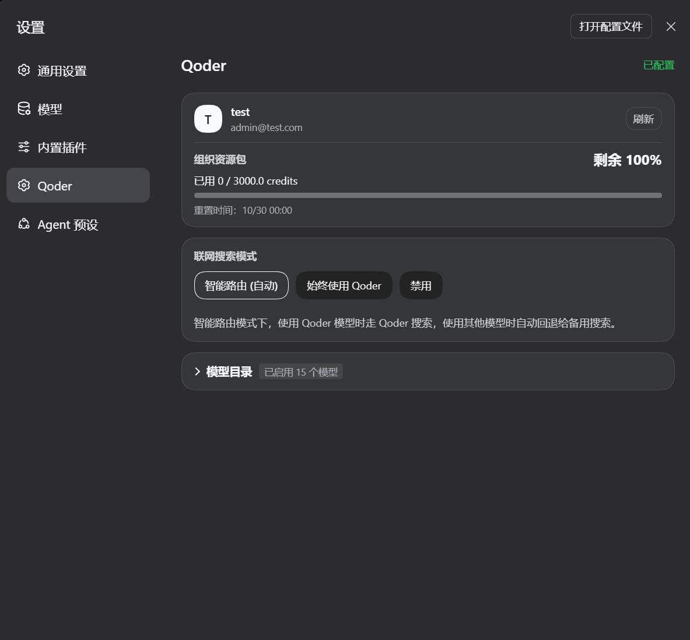

# dsh-provider-qoder

[](https://www.npmjs.com/package/dsh-provider-qoder)
[](LICENSE)
[](https://github.com/mo-n/dsh-provider-qoder)
[](https://awesome-dsh-plugin.com)

[English](./README.md) | 简体中文

在 DeepSeek Harness（DSH）中使用 Qoder 订阅，支持多模态、联网搜索和工具调用，可选择国际版或中国区 Qoder 服务。

插件负责认证和模型通信，工具执行、工作区操作及权限管理由 DSH 负责。
本项目是社区适配插件，与 Qoder、DeepSeek 官方均无关联。

## 功能

- 通过 Qoder 官网浏览器授权或 Personal Access Token（PAT，个人访问令牌）访问订阅。
- 支持国际版（`global`）和中国区（`china`）服务。
- 自动拉取账号可用模型，支持选择启用的模型，并在服务支持时显示价格倍率和推理强度选项。
- 支持多模态、搜索以及工具调用。
- 提供 `ImageSearch` 图片搜索与 `ImageGen` 图片生成，可独立开启或关闭；生成图片保存为 DSH 附件，可通过原生 `read_image` 查看。
- 在设置中查看账号信息、额度和重置时间。
- 支持 Qoder 模型排队：可取消轮询、显示等待进度。

## 安装

### 使用前提

- 拥有与所选服务区域匹配的可用 Qoder 订阅。
- 运行插件的 DSH profile 必须提供托管凭据服务；通过设置页面配置时，凭据存储还需可写。
- 环境要求：DSH `>=0.1.7-rc.2`。

### 从 npm 安装

在终端执行：

```sh
dsh plugin --profile web add dsh-provider-qoder
```

## 配置与使用

### 1. 选择服务区域并登录

打开 DSH Web 的 **设置 → 模型 → Qoder 账号**，选择对应服务区域：

| 服务区域 | 对应账号 |
| --- | --- |
| 国际版（Global，默认） | `qoder.com` |
| 中国区（CN） | `qoder.com.cn` |

点击 **通过 Qoder 登录**，在官网完成授权。返回 DSH 后即可选择账号支持的模型。

也可选择 **使用 PAT**，填写令牌后点击 **保存并使用 PAT**，或使用已保存的 PAT。通过 **管理账号** 或 **管理凭据** 更换账号、切换鉴权方式或移除授权。

浏览器授权按区域保存、由当前 DSH 实例共享，并自动续期。授权失效后需重新登录，不会自动回退到 PAT；移除授权不会退出 Qoder 官网。

### 2. 查看账号与设置模型

打开 **设置 → Qoder** 查看账号额度，并可切换联网搜索策略与调整启用的模型。

功能设置提供 **联网搜索模式：自动 / 始终使用 Qoder / 关闭**，以及独立的 **图片搜索**、**图片生成** 开关。两个图片开关默认开启，关闭后不再提供对应工具，已开始的调用继续完成。图片功能使用当前区域的 Qoder 授权，与聊天模型是否支持图片输入无关；使用 `read_image` 查看生成图片仍需支持图片输入的模型。图片生成可能消耗订阅 Credits。

`ImageSearch` 返回图片与来源 URL；`ImageGen` 接受 `name`、`prompt` 和可选 `size`，默认尺寸为 `1024x1024`。生成结果以原始字节保存到 DSH 附件存储，不直接写入工作目录。工具需要宿主提供 DSH tools；图片交付还需要附件存储与执行环境路径映射。插件不另行注册或控制 `read_image`。

<p align="center">
  
</p>

高级 YAML 配置（排队等待上限、请求超时与历史推理内容保留）见 [配置说明](./docs/wiki/configuration_CN.md)。

## 后续计划

- [ ] 接入 Qoder 的 Protobuf 协议

## 参考项目

- [pi-provider-qoder](https://github.com/simonsmh/pi-provider-qoder) - Qoder 认证、API 通信及协议处理的参考实现。

## 反馈

请通过 [GitHub Issues](https://github.com/mo-n/dsh-provider-qoder/issues) 提交问题，附上插件和 DSH 版本、所选服务区域、复现步骤及脱敏后的错误信息。不要提交 PAT、短期令牌或个人账号信息。

## 许可证

本项目基于 [MIT License](LICENSE) 开源。
