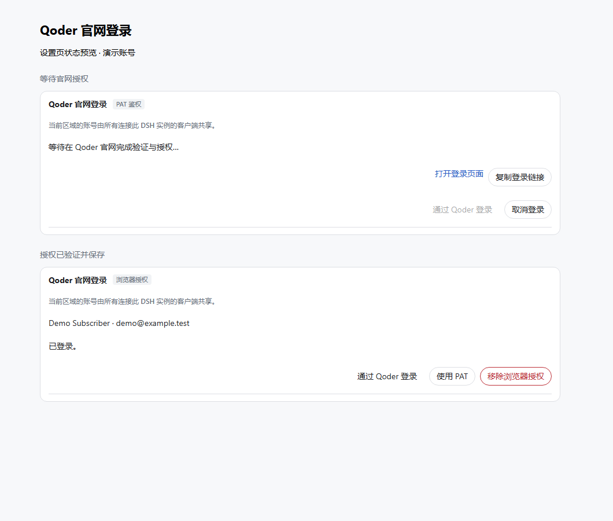

# dsh-provider-qoder

[](https://www.npmjs.com/package/dsh-provider-qoder)
[](LICENSE)
[](https://github.com/mo-n/dsh-provider-qoder)
[](https://awesome-dsh-plugin.com)

[English](./README.md) | 简体中文

在 DeepSeek Harness（DSH）中使用 Qoder 订阅，支持多模态、联网搜索和工具调用，可选择国际版或中国区 Qoder 服务。

插件负责认证和模型通信，工具执行、工作区操作及权限管理由 DSH 负责。
本项目是社区适配插件，与 Qoder、DeepSeek 官方均无关联。

## 功能

- 通过 Qoder 官网浏览器授权或 Personal Access Token（PAT，个人访问令牌）访问订阅。
- 支持国际版（`global`）和中国区（`china`）服务。
- 自动拉取账号可用模型，支持选择启用的模型，并在服务支持时显示价格倍率和推理强度选项。
- 支持多模态、搜索以及工具调用。
- 在设置中查看账号信息、额度和重置时间。
- 支持 Qoder 模型排队：可取消轮询、显示等待进度。

## 安装

### 使用前提

- 拥有与所选服务区域匹配的可用 Qoder 订阅。
- 运行插件的 DSH profile 必须提供托管凭据服务；通过设置页面配置时，凭据存储还需可写。
- 环境要求：DSH `>=0.1.7-rc.2`。

### 从 npm 安装

在终端执行：

```sh
dsh plugin --profile web add dsh-provider-qoder
```

## 配置与使用

### 1. 选择服务区域并登录

打开 DSH Web 的 **设置 → 模型**，找到页面底部的 **Qoder 凭据** 卡片，点击 **编辑**。

| 服务区域 | 对应账号 |
| --- | --- |
| 国际版（Global，默认） | `qoder.com` |
| 中国区（CN） | `qoder.com.cn` |

选择与账号一致的区域并保存，然后点击 **通过 Qoder 登录**，在新标签页的 Qoder 官网完成验证与授权。返回 DSH 后会自动显示登录结果；如果没有自动打开页面，可以点击 **打开登录页面** 或复制登录链接。登录链接约五分钟有效，可以主动取消；刷新 DSH 页面不影响后端等待，重启 DSH 会取消尚未完成的登录。

浏览器授权按区域独立保存，由连接同一 DSH 实例的所有客户端共享。插件自动续期；明确失效后需要重新登录。重新登录失败不会替换原授权。**移除浏览器授权** 只清除 DSH 保存的授权，不会退出 Qoder 官网，也不会自动使用已保存的 PAT。

<p align="center">
  
</p>

也可以在 **Qoder PAT** 编辑区填写 PAT 并保存，或点击 **使用 PAT** 切换到已有 PAT。原有 PAT 配置继续兼容；插件不会在浏览器授权失败时自动回退到 PAT。浏览器登录要求 DSH 凭据服务支持可写的授权记录，不支持的宿主仍可使用 PAT。

保存后，插件会拉取账号支持的模型列表，即可在 DSH 模型选择器中选用。

### 2. 查看账号与设置模型

打开 **设置 → Qoder** 查看账号额度，并可切换联网搜索策略与调整启用的模型：

<p align="center">
  
</p>

高级 YAML 配置（排队等待上限、请求超时与历史推理内容保留）见 [配置说明](./docs/wiki/configuration_CN.md)。

## 后续计划

- [ ] 接入 Qoder 的 Protobuf 协议

## 参考项目

- [pi-provider-qoder](https://github.com/simonsmh/pi-provider-qoder) - Qoder 认证、API 通信及协议处理的参考实现。

## 反馈

请通过 [GitHub Issues](https://github.com/mo-n/dsh-provider-qoder/issues) 提交问题，附上插件和 DSH 版本、所选服务区域、复现步骤及脱敏后的错误信息。不要提交 PAT、短期令牌或个人账号信息。

## 许可证

本项目基于 [MIT License](LICENSE) 开源。
