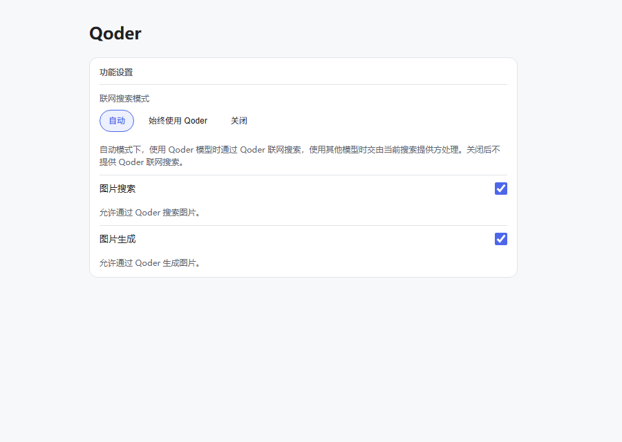

# 插件配置

[English](./configuration.md) | 简体中文

Web profile 配置文件：`~/.dsh/profiles/web/cordis.patch.yml`。使用其他 profile 时替换 `web`。

在已有 Qoder 插件条目的 `config` 中按需配置，保留其他字段：

```yaml
- id: provider-qoder
  name: dsh-provider-qoder
  config:
    modelTransport: legacy
    requestCompression: false
    modelQueueMaxWaitMs: 3600000
    responseHeaderTimeoutMs: 60000
    streamIdleTimeoutMs: 300000
    preserveThinking: true
```

以下选项仅通过 YAML 配置，设置页面不提供编辑入口。

| 字段 | 默认值 | 说明 |
| --- | --- | --- |
| `modelTransport` | `legacy` | COSY 模型渠道；显式选择 `http` 使用 Bearer model-server 请求 |
| `requestCompression` | `false` | 设置为 `true` 开启 Zstd 请求体压缩 |
| `modelQueueMaxWaitMs` | `3600000`（60 分钟） | 单次逻辑模型调用的累计排队上限，多次排队共用，不包含正常生成耗时 |
| `responseHeaderTimeoutMs` | `60000`（1 分钟） | 等待模型请求 HTTP 响应头的时限 |
| `streamIdleTimeoutMs` | `300000`（5 分钟） | 流式响应等待下一段数据的时限，收到数据后重新计时 |
| `preserveThinking` | `true` | 后续请求携带历史 Qoder 推理内容；不控制思考开关或强度，不删除聊天记录 |

## 功能设置

以下选项也可在 **设置 → Qoder → 功能设置** 中修改：

```yaml
  config:
    webSearchMode: auto
    imageSearchEnabled: true
    imageGenEnabled: true
```

| 字段 | 默认值 | 行为 |
| --- | --- | --- |
| `webSearchMode` | `auto` | `auto`：Qoder 模型走 Qoder 搜索，其他模型交给当前搜索提供方；`always`：始终使用 Qoder；`disabled`：关闭 Qoder 联网搜索 |
| `imageSearchEnabled` | `true` | 公布并允许调用 `ImageSearch`，返回图片与来源信息，不下载图片 |
| `imageGenEnabled` | `true` | 公布并允许调用 `ImageGen`，创建图片并以原始字节保存为 DSH 文件附件 |

两个开关独立于联网搜索模式，仅影响新调用，已开始的调用使用原传输实例并正常完成。图片工具使用所选 Qoder 服务区域与授权，不自动回退到其他图片提供方。`ImageGen` 使用 `ge3i`，默认尺寸为 `1024x1024`，可能消耗订阅 Credits。生成文件可通过宿主既有 `read_image` 查看，但查看时聊天模型必须支持图片输入。本插件不增加 `read_image` 开关。

宿主需提供 DSH tools，图片生成还需要原样附件存储与执行环境文件路径映射。图片存入附件存储，不直接写入工作目录。生成失败不会自动重新提交；生成后的交付失败不应通过再次生成来重试下载或保存。

<p align="center">
  
</p>

## 模型传输渠道

`modelTransport` 支持 `legacy` 和 `http`：

- `legacy`（默认）：通过 COSY 渠道发送模型请求。
- `http`：通过 Bearer model-server 渠道发送模型请求。

渠道仅通过 YAML 选择，设置页面不提供切换入口，发生错误时也不会自动切换渠道。
此配置仅影响模型请求；账号读取、模型发现、图片发布和联网搜索继续使用各自的传输路径。

例如，选择 HTTP 渠道并保持压缩关闭时，在已有插件条目中设置：

```yaml
  config:
    modelTransport: http
    requestCompression: false
```

## 请求体压缩

`requestCompression` 为布尔值，默认 `false`，对两种模型渠道均有效。在 YAML 中设置为
`true` 可开启 Zstd 请求体压缩。渠道选择与压缩开关相互独立，修改其中一个不会改变另一个。

开启后，满足条件且至少包含 4096 个字符的请求体会尝试压缩。较小请求、缺少原生 Zstd
支持或压缩失败时，发送未压缩请求。是否启用压缩由 YAML 配置决定。

仍支持以下可选环境变量，用于调整开启后的压缩参数：

| 环境变量 | 默认值 | 可选值 |
| --- | --- | --- |
| `QODER_ZSTD_REQUEST_BODY_MIN_CHARS` | `4096` | 正整数，表示请求体字符数阈值 |
| `QODER_ZSTD_REQUEST_BODY_LEVEL` | `1` | `1` 到 `22` 的整数 |

无效参数使用默认值；这两个环境变量均不会开启压缩。

## 配置生效

- 时间单位均为毫秒，要求正整数；排队上限最大为 `2147483647`。`0` 不表示无限等待。
- `preserveThinking` 与 `requestCompression` 使用布尔值 `true` / `false`，不加引号。
- 删除字段恢复默认值；以前通过 UI 保存的排队上限继续有效。
- 配置加载后对新调用生效，已开始的调用保持原配置。未自动加载时，重载对应 profile 或重启 DSH。
